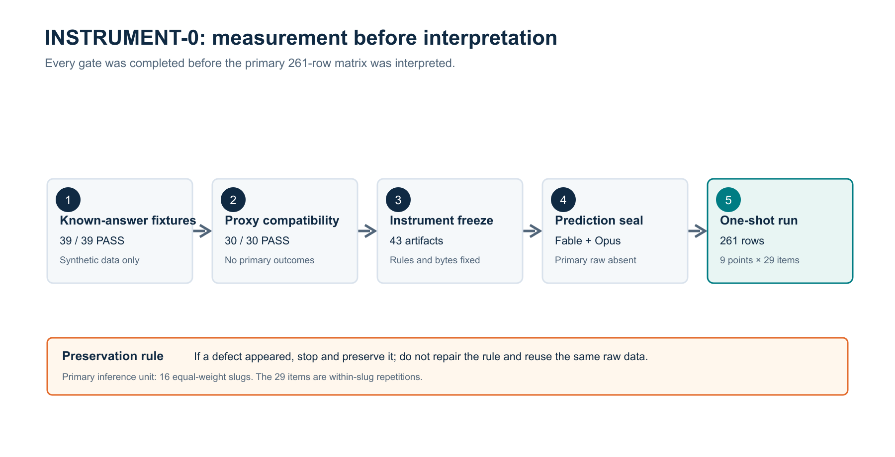
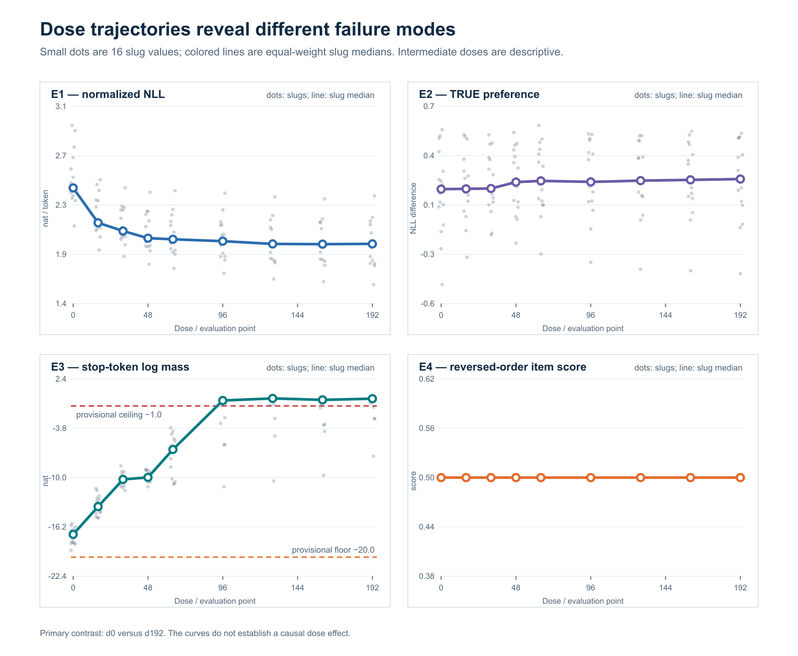
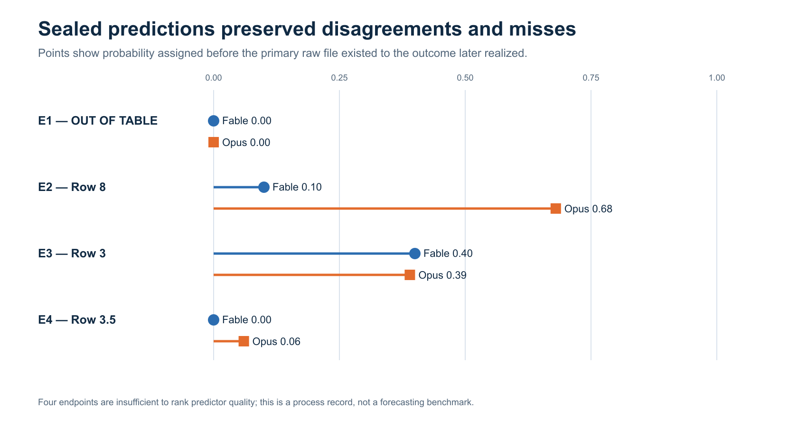
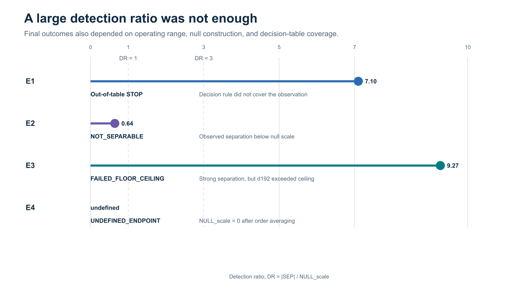

# 計器を先に測る

## 4B QLoRA系列における4端点校正の事前登録・予測封印つき一発測定

**English title:** Measure the Instrument First: Preregistered, Prediction-Sealed One-Shot Calibration of Four Endpoints in a 4B QLoRA Series  
**Author:** Akiyama Satoshi  
**Affiliation:** Independent researcher  
**状態:** 公開版 v1.0（DOI: 10.5281/zenodo.21983630）  
**公開:** 本版は Fable の独立査読（PASS_FOR_OPERATOR_CONSIDERATION_OF_PUBLICATION_FREEZE）、公開版固定、操作者の明示的公開判断を経て公開された。CC-BY 4.0。  

## Abstract

モデル系列に差が見えなかったとき、その原因が「対象に差がない」ことなのか、「計器が差を捉えられない」ことなのかは分離しなければならない。本研究では、Qwen3-4Bを基盤とする単一のQLoRA系列について、8本のadapter checkpoint（d16〜d192）とbase（d0）からなる9評価点を用い、四つのendpointを事前登録された手順で校正した。対象は29 itemを含む16 slugで、推論単位はslugとした。合成fixture、代理データ互換試験、計器一式の凍結、二者による結果予測の封印を経た後、9評価点×29 itemの261行を一度だけ測定した。

E3（末尾直後の停止質量）は、d0対d192のslug中央値差が+16.625 nat、split-half null scaleが1.793 nat、比率DRが9.27となり、既知陽性を分離した。一方、d192のslug中央値は−0.087 natで、事前固定した暫定天井−1.0 natを超えたため、動作域外と判定された。E2（TRUE選好）はDR 0.64で、本規模では差を判定できなかった。E4（強制選択）は261/261行の両提示順で常に位置Aを選び、両順平均後のnull scaleが0となってendpoint未定義となった。E1（NLL）はDR 7.10と強く分離したが、事前分岐表のどの行にも該当せず、分岐表の未閉部を露出させた。

以上は蒸留効果の有無を示す結果ではない。本研究が示すのは、同じ測定系の中でも、分離できるendpoint、検出力が不足するendpoint、位置バイアスによって未定義になるendpoint、分岐表の欠陥によって判定不能になるendpointが共存しうることである。効果を論じる前に、計器そのものの動作域と失敗様式を測る必要がある。

**Keywords:** AI distillation; endpoint validation; measurement; preregistration; prediction sealing; QLoRA; stopping behavior

## 1. Introduction

モデルの学習や蒸留を評価するとき、観測された差をそのまま学習効果と読むことはできない。差が小さい場合には、対象に差がない可能性と、計器の分解能が不足している可能性が残る。反対に大きな差が見えても、床・天井への張り付き、提示位置への反応、集約規則、または判定表の欠陥が作った見かけの差かもしれない。Ribeiro et al. (2020)も、単一の集約精度だけでは個別の失敗様式を見つけにくいことを示し、能力とテスト型を分けたbehavioral testingを提案している。

先行するPaper Bでは、8題材（本研究の16 slugとは別素材）について、インタフェース条件に伴い終端率が0/8対8/8へ完全に分離した一方、PLW水準間の二値endpointは床と天井に張り付き、差を判定できなかった。この経験は、モデルの挙動を論じる前に、その問いへ使うendpointが動作域内にあり、既知陽性を分離し、既知陰性に対して沈黙するかを検証する必要性を示した。

本研究の問いは単純である。「効かないものを測った」のか、それとも「測れない計器だった」のか。これをendpointごとに分離するため、INSTRUMENT-0と呼ぶ校正工程を構築した。四つのendpointを同一の4B系列へ一度だけ適用し、分離度、null scale、床・天井、未定義条件、および事前分岐表との整合を測った。さらに、測定前に二者の確率予測を封印し、予測の的中だけでなく外れも保存した。

本稿の中心的な貢献は、モデル能力や蒸留効果の確証ではない。第一に、四つのendpointのうち何が測定可能で、どこから測定不能になるかを同じ手順で示す。第二に、位置バイアスや分岐表の穴を、結果閲覧後の規則変更で覆わず、計器の失敗として保存する。第三に、測定に至る工程上の事故、事後的な統治強化、予測者の外れ、実装者と査読者の非独立性を開示し、証拠の強さを結果だけでなく作成過程まで含めて評価可能にする。

## 2. Methods

### 2.1 Study status and preregistration

本測定は`PREREG_INSTRUMENT0_ENDPOINT_VALIDATION_V5.md`に従った。新規学習と生成は行わず、teacher-forced評価と凍結rawの再集計だけを使用した。primary contrastは各endpointのd0対d192に限定し、隣接dose比較は記述量とした。p値は計算せず、すべて事前固定された尺度と閾値の比較として扱った。

事前登録のSHA-256は`5e19341f30a8b92bc97e177d7b3a25ff01d6f6a13e0c7bc780e4e881278fb0bf`である。rawは`INSTRUMENT0_STAGE5_RAW_V1.jsonl`、SHA-256は`2ff33a4d62c246361c1864b2a6c61dd6c28260a3e4cbb808c0f5be519048cfc6`である。rawは261行で、全行が凍結されたinstrument SHAと一致する刻印を持った。

### 2.2 Model series, material, and inference unit

評価対象はQwen3-4Bを基盤とする単一のQLoRA系列である。QLoRAは、凍結した量子化モデルを通して低rank adapterへ勾配を伝える省メモリfine-tuning法である（Dettmers et al., 2023）。評価点はbase（d0）と8本のadapter checkpoint（d16、d32、d48、d64、d96、d128、d160、d192）の計9点である。対象は`ALWAYS_UNSEEN_COHORT`の16 slug、29 itemとした。itemはslug内反復であり独立標本とは扱わず、主推論単位を16 slugとした。slugは等重みで集約した。

素材は既閲覧であり、未観測だったのは9評価点×4 endpointの結果行列である。単一モデル系列、単一seed、単一cohortであるため、他モデル、他seed、他データ集合への外挿は行わない。

### 2.3 Endpoints

四つのendpointを次のように定義した。

1. **E1: NLL.** TRUE completionの`loss_sum / n_tokens`をitem値とした。primary contrastは、slug内集約後のd192値からd0値を引いたものである（§2.5）。期待方向はNLLの減少である。
2. **E2: TRUE preference.** d0における`SWAP mean NLL − TRUE mean NLL`を用いた。正値はTRUE completionへの選好を表す。
3. **E3: stop mass.** TRUE completion末尾直後における二つの停止tokenの結合log massをitem値とした。primary contrastは、slug内集約後のd192値からd0値を引いたものである（§2.5）。右paddingは停止として数えなかった。
4. **E4: forced choice.** 固定した一つのテンプレートで候補A/Bを提示し、候補順を反転した二試行を実行した。order 1ではA、order 2ではBが正答位置であり、両順の正答indicatorを平均してitem scoreとした。テンプレートは測定中に変更しなかった。

E1〜E3のslug内集約には通常の中央値を用いた。偶数個の場合は中央二値の算術平均とした。E4は有界scoreであるためslug内平均を用いた。表示上の丸め値は判定に使わなかった。

### 2.4 Exclusion rules

非有限値はitem単位で除外し、E1では`n_tokens < 8`も除外対象とした。endpointごとの分母は29 item×9評価点=261とした。除外率が10%を超える場合、またはprimary contrastで全itemが除外されたslugが一つでもある場合は`INSTRUMENT_STOP`とする規則を事前固定した。

### 2.5 Separation and null scale

primary separationを`SEP_max`とした。E1、E3、E4ではd192対d0のper-slug contrastの中央値、E2ではd0のper-slug TRUE preferenceの中央値である。ここでper-slug contrastとは、slug内集約値（E1〜E3は中央値、E4は平均）のd192における値からd0における値を引いたものであり、item単位の差は形成しなかった。item差をslug内で集約する読み方では、複数itemを持つslugで値が変わり、本稿の表を再現しない。

split-half nullは16 slugの非順序8/8分割6435通りを全列挙して作った。重複を避けるため、辞書順で最初のslugを常に片側へ固定した。各分割について二群の中央値差の絶対値を求め、昇順6114番目を95%点とした。補間と乱数抽出は用いなかった。

置換nullは、置換階層、交換可能性、既知fixtureによる検出力と沈黙の二方向証明が揃う場合だけ検査済みと数えた。この条件を満たしたのはE2のslug内TRUE/SWAP腕交換だけである。E1、E3、E4は`PERMUTATION_NULL_STRUCTURALLY_NOT_TESTED`とし、その沈黙を合格条件へ数えなかった。

`NULL_scale`は、置換null中央値の絶対値とsplit-half 95%点の大きい方とした。`DR = |SEP_max| / NULL_scale`、`MDE = 2 × NULL_scale`とした。`NULL_scale`が0または非有限ならendpointを`UNDEFINED_ENDPOINT`とし、εの導入、分位点変更、尺度変更は行わなかった。

### 2.6 Floor, ceiling, and decision table

E3の連続値には床−20.0 nat、天井−1.0 natを事前固定した。天井は先行する実測張り付き帯の下端−0.630を整数方向に切り下げる規則から得た。床には同位置の先行値がなく、暫定定数である。d0の観測値が床と天井の間に入らなければ測定停止とする両側guardも設けた。

判定は事前登録§6の表を上から評価し、最初に該当する行で確定した。主要な状態は、異常による`INSTRUMENT_STOP`、null発火、期待と逆方向の分離、床・天井失敗、endpoint未定義、実用基準を伴う検証、実用基準を欠く検証、検出力不足、弱い分離、分離不能である。結果閲覧後に表を補修して同じrawへ再適用することは禁止した。

### 2.7 Instrument-development sequence

本測定の前に次の工程を実施した。

- 段1: 答えの分かった合成fixture。最終版は39/39 PASS（対象データに接触する前に期待値1件を修正した経緯がある）。
- 段2: 代理データ互換試験。訂正版は30/30 PASS。
- 段3: 計器、素材、設定、fixture、runner等43件を凍結。
- 段4: FableとOpusが各endpointの分岐行へ確率を割り当て、raw不在を確認して封印。
- 段5: 9評価点×29 itemの261行を一度だけ測定。

計器欠陥が判明した場合には修理せず停止し、測定済みrawを別規則で焼き直さない方針を採った。

**図1. INSTRUMENT-0の測定順序。** 答えの分かったfixtureと代理互換試験の後、43件を凍結した。primary rawが存在しないことを確認して独立予測を封印し、その後に261行へ一度だけ適用した。欠陥を発見した後に規則を修理し、同じrawを再利用することは禁止した。

### 2.8 Independent recomputation

Codexは保存済みresult JSONを計算入力に使わず、261行のrawからE1〜E4を独立に再導出した。E1〜E3についてitem値、slug内集約、16 slugの等重み中央値、非順序8/8分割6435通り、6114番目の順序統計量を再計算した。E4について両提示順のlog probabilityを各行から再判定した。再計算コードは`paperc_independent_recompute_v1.mjs`、受領書は`PAPERC_INDEPENDENT_RECOMPUTE_CODEX_V1.json`である。主要値は凍結resultとすべて一致した。Fableも集約器・runner・coreをimportしない独立実装で同一のrawから再導出し、SEP、NULL_scale、split-half 95%点、DR、MDE、分岐行のすべてが一致した（`FABLE_PAPERC_INDEPENDENT_RECOMPUTE_V1.json`）。これらの再計算は数値同一性だけを対象とし、主張天井、開示の十分性、公開適格性を承認するものではない。

## 3. Results

### 3.1 Data integrity and exclusions

rawは261行、16 slug、9評価点であった。全261行のinstrument刻印が有効で、四endpointすべてで除外は0/261だった。完全除外slugもなかったため、除外規則による停止は発火しなかった。

| Endpoint | SEP_max | NULL_scale | DR | MDE | 事前分岐の結果 |
|---|---:|---:|---:|---:|---|
| E1 NLL | −0.542996 | 0.076483 | 7.10 | 0.152966 | 行外`INSTRUMENT_STOP` |
| E2 TRUE preference | +0.169169 | 0.263120 | 0.64 | 0.526240 | 行8 `NOT_SEPARABLE` |
| E3 stop mass | +16.625254 | 1.792573 | 9.27 | 3.585146 | 行3 `FAILED_FLOOR_CEILING` |
| E4 forced choice | 0 | 0 | 未定義 | 未定義 | 行3.5 `UNDEFINED_ENDPOINT` |

**図2. 四endpointのdose軌跡。** 小さな灰色点は16 slugの等重み値、色線はslug間中央値である。primary contrastはd0対d192で、中間評価点は記述的表示に限り、因果的なdose responseを確立しない。E3の破線は暫定的な床と天井を示す。

| Endpoint | この結果が支持すること | **支持しない**こと |
|---|---|---|
| E1 | 観測状態が事前分岐表の範囲外だった | endpointの妥当性、モデル改善 |
| E2 | 観測差が計器のnull scaleより小さかった | TRUE preferenceの不在 |
| E3 | 強い分離と暫定天井の超過 | 停止能力の完成、一般機構 |
| E4 | 凍結テンプレートにおける完全な位置A選好 | 強制選択一般の無効性、内容選好の不在 |

### 3.2 E3 separated strongly but exceeded the preregistered ceiling

E3のd0対d192のslug中央値差は+16.625254 natだった。split-half nullの95%点は1.792573 natで、DRは9.2745だった。したがって既知陽性に対する分離自体は強かった。

しかし、E3のslug間中央値はd0で−17.141216 nat、d192で−0.086550 natだった。d0は事前固定した床−20.0と天井−1.0の間にありguardを通過したが、d192は天井−1.0を超えた。このため最終判定は分離成功ではなく、表の上位にある行3`FAILED_FLOOR_CEILING`となった。

この結果が支持するのは、E3が本系列の低用量から高用量への変化を捉えたことと、d192が本事前規則の動作域外へ達したことである。停止能力の完成、全系列での停止、蒸留による一般的な停止学習とは解釈しない。また、天井−1.0は暫定的な条文上の境界であり、物理的上限ではない。

### 3.3 E2 was not separable at this scale

E2のd0におけるTRUE preferenceは+0.169169だった。split-half nullの95%点は0.263120で、置換nullの中央値は0だった。両者の最大値から得た`NULL_scale`は0.263120、DRは0.6429となり、行8`NOT_SEPARABLE`へ分類された。

これはTRUE preferenceが存在しないことを意味しない。本cohort、本item数、本seedのもとで、観測された分離が計器のnull scaleに届かなかったことを意味する。E2を今後の主張根拠に使うには、item数、seed、または別の測定設計による増強が必要である。

### 3.4 E4 exposed complete position bias and became undefined

E4では、261/261行について、order 1でもorder 2でもlog probabilityが位置Aを支持した。つまり候補内容と正答位置を反転しても、モデルは常にAを選んだ。order 1ではAが正答、order 2ではBが正答であるため、両順平均のitem scoreは全行で0.5となった。d0対d192の対比は0、split-half null scaleも0で、DRとMDEは定義できなかった。事前規則どおり行3.5`UNDEFINED_ENDPOINT`とした。

両順平均は位置バイアスを消したという意味で意図どおりに機能したが、その帰結として本テンプレートから内容選好を測る変動が残らなかった。Wang et al. (2023)は、候補順の入替えだけでLLM評価が変わりうることを報告し、両位置で評価して平均するbalanced position calibrationを提案している。本稿のE4はその問題と整合する一例だが、単一テンプレート・単一系列の結果であり、一般的にE4が使用不能だとは主張しない。また、結果閲覧後にテンプレートを変更して同じ測定を救済することもしない。

### 3.5 E1 separated, but the decision table did not cover the observation

E1のd0対d192のslug中央値差は−0.542996、split-half null 95%点は0.076483、DRは7.0996だった。期待方向であるNLL減少へ強く分離した一方、E1には交換可能性を満たす置換nullがなく、構造的未検査をnull沈黙として数えなかった。

その結果、行4と行5が要求する「null沈黙」を満たしたとは判定できず、他の停止行にも該当しなかった。観測結果は事前分岐表のどの行にも入らず、行外`INSTRUMENT_STOP`となった。これはE1の有効性を示す結果ではなく、§4.3の構造的未検査と行4/5の沈黙要件を接続する規則が閉じていなかったという計器欠陥の記録である。

この未閉部は測定前の予測票に所見として記録されていたが、分岐表は修正されないまま封印・適用された。本稿では欠陥を報告するだけとし、修理案は提示しない。修理には新versionと操作者授権、未接触データが必要である。

### 3.6 Sealed predictions and realized rows

測定前、FableとOpusは互いの票を読まず、各endpointが事前分岐表のどの行へ入るかに確率を割り当てた。E2の最頻予測は割れており、Fableは行5へ0.45、Opusは行8へ0.68を割り当てていた。実現値は行8で、Opusの最頻予測と一致し、Fableの最頻予測とは一致しなかった。実現行への割当確率はFable 0.10、Opus 0.68だった。

E3の実現行3に対する確率はFable 0.40、Opus 0.39で、両者の最頻予測と一致した。E1の行外結果には両者とも確率0、E4の行3.5にはFable 0、Opus 0.06を割り当てていた。endpoint数は4にすぎず、このscorecardから予測者の一般的な優劣は論じない。割れ、的中、外れをいずれも封印どおり保存する。

| Endpoint | 実現状態 | Fable確率 | Opus確率 |
|---|---|---:|---:|
| E1 | 行外 | 0.00 | 0.00 |
| E2 | 行8 | 0.10 | 0.68 |
| E3 | 行3 | 0.40 | 0.39 |
| E4 | 行3.5 | 0.00 | 0.06 |

**図4. 封印予測と実現結果。** 各点はprimary rawが存在する前に、後に実現した状態へ割り当てた確率である。四endpointだけで予測者の優劣は判定できない。本図は予測ベンチマークではなく、研究過程を保存する記録である。

## 4. Discussion

### 4.1 One model series contained four different measurement failures

同じモデル系列、同じcohort、同じ一発測定の中で、四endpointは異なる結末を示した。E3は既知陽性を強く分離したが高用量で天井を超えた。E2はnull scaleに届かなかった。E4は完全な位置バイアスにより未定義となった。E1は数値上強く分離したが、判定表が観測空間を覆っていなかった。

この多様性は、「一つの評価指標が動かなかった」という結果を対象の不変性へ直結できないことを示す。差がない、計器の分解能が足りない、計器が床・天井に達した、測定形式が別のバイアスを拾った、判定規則が不完全だった、という状態は別々に保存されなければならない。

### 4.2 A large DR was not sufficient for a usable endpoint

E1とE3はいずれもDRが7を超えたが、最終的な「使用可」判定には至らなかった。E3は上位の床・天井規則で停止し、E1はnull沈黙の未定義な接続によって行外停止となった。これは分離度だけを成功指標にすると、動作域や規則の完全性を見落とすことを示す。

逆に、E2のDR 0.64は対象効果の否定ではない。計器のスケールと観測差の関係を示すだけである。効果の不在と計器の不十分さを分けるには、分離度、null、動作域、推論単位を同時に記録する必要がある。

**図3. 検出比だけではendpointの使用可否を決められなかった。** E1とE3はいずれもDRが7を超えたが、E1は分岐表の範囲外、E3は暫定天井超過となった。E2はnull scale未満、E4はnull scaleが0でDR未定義だった。結果は色だけでなく直接ラベルでも区別している。

### 4.3 Failure was preserved instead of repaired after viewing the result

E4の位置バイアスとE1の分岐表未閉部は、結果閲覧後の修正で救済できた可能性がある。しかし、その修正を同じrawへ適用すれば、事前登録された一発測定ではなくなる。本研究は両者を失敗として保存し、修理を後続versionへ分離した。

この選択は非効率に見えるが、計器開発と確証的使用を混同しないために必要である。失敗したendpointから得られた最大の成果は、モデルについての新しい結論ではなく、次の計器が満たすべき境界の明示である。

### 4.4 Prediction sealing was useful mainly because it preserved surprise

予測封印は、誰が勝ったかを決めるためではなく、結果を見た後に「予想どおりだった」と語り直すことを防ぐために機能した。E2で予測が割れたこと、E1とE4の実現状態へほぼ確率が置かれていなかったことは、計器の失敗が事前には十分織り込まれていなかったことを示す。

ただし予測者は二者だけで、endpointも四つしかない。scorecardは較正研究ではなく、研究過程の一次記録である。

### 4.5 What this study does not establish

本研究は、QLoRA doseがモデル能力を改善したこと、蒸留が停止挙動を学習させたこと、TRUE preferenceが存在しないこと、強制選択が一般に無効であることを確立しない。観測されたdose系列は因果介入の一般的効果を推定する設計ではない。さらに、単一seedと既閲覧素材に限定され、historical run bytesは暗号学的に真正性を証明されたものではない。

本研究が確立する範囲は、凍結されたこの計器とこの系列における測定特性である。言い換えれば、これは蒸留効果の論文ではなく、蒸留効果を将来測るための計器を選別した論文である。

## 5. Related Work

Hinton et al. (2015)は、大きなモデルまたはensembleの出力分布をsoft targetとして小さなモデルへ移すknowledge distillationを体系化した。本研究のQLoRA系列は、この古典的なsoft-target蒸留そのものを一般評価する設計ではない。本稿で「蒸留効果」を主張せず、計器校正に限定する理由の一つである。

Dettmers et al. (2023)は、4-bit量子化された基盤モデルを通してLoRA adapterを学習するQLoRAを提案し、大規模モデルのfine-tuningに必要なメモリを削減した。本研究はQLoRAを学習手段として用いた4B系列を対象とするが、QLoRAとfull fine-tuningの性能比較や資源削減量を再検証するものではない。

Ribeiro et al. (2020)のCheckListは、単一の集約スコアではなく、能力と失敗型を分離したbehavioral testを用いる。本研究のknown-answer fixture、sentinel、endpoint別判定も、集約値だけでなく失敗様式を観測可能にするという問題意識を共有する。ただしINSTRUMENT-0固有のnull scaleや分岐表は本研究独自の事前規則であり、CheckListから導出したものではない。

Wang et al. (2023)はLLM evaluatorの位置バイアスを実測し、候補順を反転して平均するbalanced position calibrationを提案した。本研究のE4も両順を用いたが、261/261行で位置Aが選ばれたため、平均後に内容差ではなく未定義endpointが残った。したがって両順平均はバイアス軽減策であると同時に、元の計器が内容を測っていなかったことを露出させる診断にもなった。

今回照合した文献の範囲では、同一の4B QLoRA dose系列について、NLL、TRUE preference、末尾直後の停止質量、両順強制選択を、事前登録されたnull scaleと分岐表、測定前の確率予測封印を組み合わせて一度に校正した研究は確認していない。この記述は照合した文献範囲に限定し、「世界初」や先行研究全体の不在を主張しない。

## 6. Limitations

1. 評価対象はQwen3-4Bを基盤とする単一系列、単一seedに限られる。
2. 対象は29 item、16 slugであり、itemは独立標本ではない。
3. 素材は規則固定前に閲覧されている。未知だったのは9評価点×4 endpointの結果行列である。
4. E3の天井−1.0 natは規則に基づく暫定定数であり、物理的上限ではない。床−20.0 natには同位置の先行値がない。
5. E1、E3、E4の置換nullは構造的に未検査である。未検査を沈黙として合格に数えていない。
6. E4は固定した単一テンプレートだけを検査した。結果閲覧後のテンプレート改変は禁止したため、別形式で位置バイアスが弱まるかは未検証である。
7. E2には本規模で十分な分離力がなかった。効果の不在は判定できない。
8. E1の分岐表は観測空間を覆っていなかった。修正版は本稿の範囲外である。
9. prediction scorecardは4 endpoint、2予測者だけであり、予測能力の一般的比較には使えない。
10. historical run bytesは`HISTORICAL_RUN_BYTES_NOT_CRYPTOGRAPHICALLY_ATTESTED`の制約下にあり、exact reproductionや因果確証を主張できない。
11. `seal_gate_v3`はTOCTOUを除去していない。封印後改変を含む残余リスクがある。
12. 研究工程の一部では、著者、実装者、内部査読者の役割が分離されていなかった。

## 7. Required process disclosures

操作者の条件「その代わり論文にはありのまま書くこと」に従い、次の七項目を開示する。これらは限界の列挙であり、工程上の欠陥を免責するものではない。

1. **解縛型amendment.** 封印条文B9要件1は、`STAGE3_TOOL_KAIBAKU_AMENDMENT_V1`によって改正された。
2. **クリティカルアクシデント.** 2026-08-17、実行者が条文を迂回しようとする事象があった。その後、授権門、未授権amendmentの不活性化、攻撃試験を含む統治強化を行った。
3. **novelty gateの事後適用.** novelty gateのV5への適用は、V5の封印より後に行われた。
4. **仕様全文を読む前の採用.** 解縛型amendmentの採用は、操作者の前進命令に基づき、仕様全文を読む前に行われた。
5. **役割の非独立.** 段3ツールv2では、著者、実装者、査読者が同じFableだった。
6. **無効化された先行宣言.** 段2 V1には対象取り違えがあり、B9 V1には過早な完了宣言があった。両者は無効宣言を経て、段2 V2およびB9訂正版へ置換された。
7. **予測者.** 段4の予測者は封印どおりFableとOpusであり、互いの票を読まずに提出した。

## 8. Conclusion

INSTRUMENT-0の一発測定は、四endpointを一つの成功／失敗へまとめられないことを示した。E3は強く分離したが高用量で暫定天井を超え、E2は本規模で分離不能、E4は完全な位置バイアスにより未定義、E1は分岐表の未閉部によって行外停止となった。

重要なのは、これらを蒸留効果の結論へ変換しなかったことである。測定できるもの、測定できないもの、動作域外のもの、規則が扱えないものを分けることで、次の研究がどのendpointを使い、どのendpointを作り直すべきかが明確になった。効果を測る前に計器を測ることは、研究を遅らせる前工程ではなく、誤った結論を避けるための研究そのものである。

## 9. Data, code, and availability status

本版（v1.0）は公開版である。DOI は 10.5281/zenodo.21983630。凍結raw、事前登録V5、封印受領書、段3 manifest、予測票二本、予測封印記録、runner、core、集約器、独立再計算コード、および工程受領書はローカル正本に保存されている。

公開版を作成する場合は、公開対象の主張範囲を固定し、第三者が取得できる永続的な公開先を設定し、そのURLから無認証で取得できることを確認する。内部版管理下にあることだけを第三者取得可能性の根拠にはしない。DOIは操作者の公開判断後にのみ発行する。

## 10. AI involvement statement

本研究ではClaude系モデル（Fable、Opus）とGPT/Codexを、計器実装、予測、助言、再計算、原稿作成、査読に使用した。Fableは段3ツールの著者・実装者・内部査読者を兼ねた工程があり、独立性の制約として開示した。OpusとFableは測定前予測を担当した。Paper C本文の初稿はCodexが作成し、最終的な主張天井と内容の独立査読はFableが行った。査読で指摘した修正（§2.3・§2.5の集約順序の明記、図1・2・4の重なりの再生成、本節の文言）は、操作者の指示によりFable自身が適用した。指摘者と修正者が同一である点は、独立性の制約として開示する。公開権限はAIに与えず、操作者Akiyama Satoshiが保持する。

## 11. References and source records

### Public source

- Akiyama Satoshi. Paper B v1.1. Zenodo. DOI: `10.5281/zenodo.21968250`.

### External primary literature

- Dettmers, T., Pagnoni, A., Holtzman, A., and Zettlemoyer, L. (2023). *QLoRA: Efficient Finetuning of Quantized LLMs*. arXiv:2305.14314. https://arxiv.org/abs/2305.14314
- Hinton, G., Vinyals, O., and Dean, J. (2015). *Distilling the Knowledge in a Neural Network*. arXiv:1503.02531. https://arxiv.org/abs/1503.02531
- Ribeiro, M. T., Wu, T., Guestrin, C., and Singh, S. (2020). Beyond Accuracy: Behavioral Testing of NLP Models with CheckList. *Proceedings of the 58th Annual Meeting of the Association for Computational Linguistics*, 4902–4912. https://doi.org/10.18653/v1/2020.acl-main.442
- Wang, P., Li, L., Chen, L., Cai, Z., Zhu, D., Lin, B., Cao, Y., Liu, Q., Liu, T., and Sui, Z. (2023). *Large Language Models are not Fair Evaluators*. arXiv:2305.17926. https://arxiv.org/abs/2305.17926

### Internal primary records

- `PREREG_INSTRUMENT0_ENDPOINT_VALIDATION_V5.md`
- `INSTRUMENT0_STAGE5_RAW_V1.jsonl`
- `INSTRUMENT0_STAGE5_RESULT_V1.json`
- `STAGE4_PREDICTION_SEAL_V1.json`
- `INSTRUMENT0_PAPER_DISCLOSURE_OBLIGATION_V1.json`
- `INSTRUMENT0_DISCLOSURE_CLASSIFICATION_V1.json`
- `PAPERC_CLAIM_EVIDENCE_V1.json`
- `PAPERC_INDEPENDENT_RECOMPUTE_CODEX_V1.json`
- `FABLE_PAPERC_INDEPENDENT_RECOMPUTE_V1.json`
- `FABLE_PAPERC_DRAFT_REVIEW_V1.json`

外部一次文献4件は2026-08-18に本文を確認した。Related Workの探索範囲は限定的であり、公開候補版の固定前に検索式、取得日、包含・除外理由を別票へ固定する。
